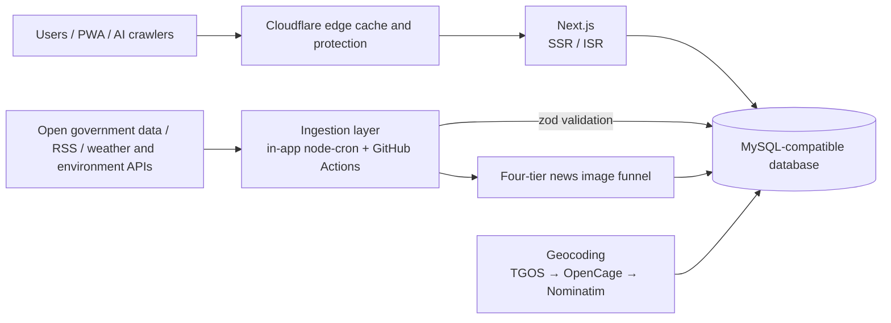

[繁體中文](README.md) | **English** | [日本語](README.ja.md) | [한국어](README.ko.md)

# j172tw Healthz

**Taiwan public-health news, everyday utility tools and real-time disaster and environment data, in one install-free website.**

[**Try it live: health.j172.tw »**](https://health.j172.tw)

<!-- The numbers below are verified against the code by tests/readme-scale-numbers.test.mjs; update all four READMEs together. -->

  
  
  
  

  
  
  
  
  
  
  
  

  
  
  
  

  
  
  

---

## What is this?

j172tw Healthz brings together **public-health news**, **everyday utility tools** and **real-time disaster and environment data** that are normally scattered across government agencies and news outlets. It works the moment you open it: no sign-up, no install, no ads. It currently offers <!--scale:tools-->86<!--/scale--> interactive tools, aggregates <!--scale:news-sources-->103<!--/scale--> news sources, and keeps its data fresh with <!--scale:cron-->45<!--/scale--> in-app scheduled jobs.

It is also a **portfolio project**: data ingestion, database, frontend, maps, multilingual support and operations automation, all running as a long-lived public information service on a resource-constrained shared host.

## Highlights

### News: official and commercial sources handled separately, no broken images
- Aggregates health and lifestyle news from government agencies, media, non-profits and fact-checking organisations (RSS plus site-specific extractors), with a freshness gate and per-source failure isolation.
- Official sources are shown in full on the site. For commercial media only the title, summary and thumbnail are stored, and a click goes back to the original site.
- **Four-tier image funnel**: the article's own image, then stock-photo fallback (Pixabay, Pexels, Unsplash, with persisted rate-limit cooldowns), then reuse of an already-collected image, then a vector cover (`ThematicCover`). Official bulletins deliberately never get stock photos; they get a vector cover instead to keep the tone serious.
- Cards from fact-checking organisations are clearly labelled as coming from the checker, not judged by this site.

### Everyday tools: <!--scale:tools-->86<!--/scale--> of them, in 7 categories
Health self-assessment (BMI, calories, blood pressure, sleep and more), medical care and medication (clinics, pharmacies, drug licences, live emergency-room crowding), long-term care and social welfare, family and children, disaster alerts, environment and food safety, and transport, daily life and culture. Categories, navigation, footer and the `/tools` index are all generated from one file, [`catalog.ts`](lib/server/tools/catalog.ts), so they cannot drift apart. There are also [`/guides`](https://health.j172.tw/guides) scenario guides, and [`/nearby`](https://health.j172.tw/nearby): locate yourself once and see the nearest AEDs, clinics, pharmacies, shelters and other urgent points together.

### Real-time disaster and environment data
- Weather alerts from Taiwan's Central Weather Administration, a typhoon banner, air quality and UV index, reservoir levels, flood sensors, water-outage notices and the power generation mix.
- Significant earthquakes are merged and de-duplicated from four sources: USGS, EMSC, the Hong Kong Observatory and Taiwan's Central Weather Administration.
- A "Global Watch" 3D globe built with MapLibre shows air quality, disasters, earthquakes, epidemics and typhoons.

### Facility maps: hundreds of thousands of records
Clinics, pharmacies, AEDs, public toilets, long-term-care and childcare facilities and more go through address normalisation and layered geocoding (TGOS, then OpenCage, then Nominatim, with a daily quota, a rotating cursor and county-boundary guards), and are shown on Leaflet maps with Google Maps navigation links. The rule is: ingest into the database first, let the frontend read only the database, and give every tool fallback data so users never see an empty page.

### Languages and accessibility
- Traditional Chinese is the default, with English, Japanese and Korean served under `/en/`, `/ja/` and `/ko/`. Japanese and Korean currently translate the interface and names; body content stays in Chinese. Lists are sorted in Taiwanese stroke order.
- There is an [accessibility statement](https://health.j172.tw/accessibility). The site is designed toward Taiwan's Accessibility Guidelines 2.1 and WCAG 2.1 AA, with keyboard access keys; articles can be read aloud or opened in an immersive reader; dark mode and PWA are supported.
- AI friendly: `llms.txt`, `llms-full.txt` and JSON-LD structured data.

## Scale

| Item | Count | How it is counted (single source of truth) |
|---|---|---|
| Interactive tools | <!--scale:tools-->86<!--/scale--> | `TOOL_CATALOG` in [`lib/server/tools/catalog.ts`](lib/server/tools/catalog.ts) |
| In-app scheduled jobs | <!--scale:cron-->45<!--/scale--> | `cron.schedule(` calls in [`lib/server/cron/registerJobs.ts`](lib/server/cron/registerJobs.ts) (GitHub Actions schedules are not included) |
| News sources | <!--scale:news-sources-->103<!--/scale--> | [`lib/server/news/sourceCategories.ts`](lib/server/news/sourceCategories.ts): 26 official agencies, 49 media, 26 non-profits, 2 fact-checkers (including sources that are no longer fetched but whose past articles are kept) |

These numbers are hand-written, so [`tests/readme-scale-numbers.test.mjs`](tests/readme-scale-numbers.test.mjs) checks them against the code on every `npm test`. If any of the four READMEs goes stale, the test fails.

## Tech stack

  
   
  
  

- **Frontend**: Next.js (App Router), React, TypeScript, Tailwind CSS, `next-themes`; Leaflet for facility maps and MapLibre GL for the 3D globe.
- **Backend**: Next.js server rendering and ISR, a `mysql2` connection pool, `zod` validation, and `cheerio` and `fast-xml-parser` for parsing source data.
- **Scheduling**: `node-cron` inside the app, plus GitHub Actions for batch jobs that need a clean egress IP or run for a long time.
- **Edge and deployment**: Cloudflare in front for caching and protection; GitHub Actions builds and ships the prebuilt output over FTPS, and PM2 keeps the process running.

## Architecture

The system is deliberately built for a resource-constrained shared host: no global `fetch()` on the server (a home-grown `node:https` client is used instead), no WASM or image transcoding at request time, and a schema that `ensureSchema()` fills in idempotently at startup. See the [architecture overview](docs/architecture.md) for details and trade-offs.

## Documentation

Development, operations, incident write-ups and per-feature decisions live in `docs/` (written in Traditional Chinese) and are not repeated here:

- Index: [docs/README.md](docs/README.md)　Architecture: [docs/architecture.md](docs/architecture.md)
- News: [01 sources](docs/domains/01-news-sources.md), [02 images](docs/domains/02-news-images.md), [03 geo and landmarks](docs/domains/03-news-geo-landmark.md)
- Tools: [04 information architecture](docs/domains/04-ia-navigation-civic.md), [05 medical and food](docs/domains/05-tools-medical-food.md), [06 welfare and family](docs/domains/06-tools-welfare-family-culture.md), [07 disaster, environment and energy](docs/domains/07-tools-disaster-environment-energy.md)
- Data: [08 facilities and maps](docs/domains/08-facilities-geocode-maps.md), [09 database and data integrity](docs/domains/09-database-data-integrity.md)
- Operations: [10 scheduling and CI/CD](docs/domains/10-scheduling-sync-ci.md), [11 hosting and ops](docs/domains/11-hosting-ops-incidents.md)
- Frontend and quality: [12 frontend stability](docs/domains/12-frontend-stability.md), [13 SEO, performance, i18n and AI](docs/domains/13-seo-performance-i18n-ai.md)

## License and data notice

This project uses a composite dual-license (SPDX identifier: `MIT AND CC0-1.0`) that separates software source code from structured open data. The full text is in [LICENSE](LICENSE).

| Scope | License | Contents |
|---|---|---|
| Software source code | MIT License | The Next.js app, React components, Tailwind CSS, vector SVG covers, backend pipelines and the native HTTP client; free to modify, distribute and use commercially |
| Derived structured data and metadata | CC0-1.0 Universal | Database schemas and normalisation dictionaries, AI structured news summaries (`geo_summary`), geocoding enrichment and calculation-model algorithms; all copyright waived, openly available to AI agents |

* **Source code**: [MIT License](LICENSE).
  * Copyright (c) 2023 Next.js Templates
  * Copyright (c) 2026 j172tw (https://health.j172.tw)
* **Derived structured data and metadata**: released under the [CC0-1.0 Universal Public Domain Dedication](https://spdx.org/licenses/CC0-1.0), for the open-source community and AI agents to use freely.
* **Taiwan Open Government Data notice**: the upstream public-health, weather, transport and environmental data aggregated here remains the property of the Ministry of Health and Welfare, the Central Weather Administration, the Ministry of Environment, the Ministry of Economic Affairs, the Ministry of Transportation and Communications and local governments of the Republic of China (Taiwan), and is used under the [Open Government Data License, version 1.0](https://data.gov.tw/license) (OGDL-Taiwan-1.0).

Data sources include public data from the Ministry of Health and Welfare (including the National Health Insurance Administration, Health Promotion Administration, Centers for Disease Control and Food and Drug Administration), the Central Weather Administration, the Ministry of Environment, the Water Resources Agency, the Ministry of Transportation and Communications (TDX), the Ministry of Agriculture, the Ministry of Culture, the Ministry of Education, the Hakka Affairs Council, the Ministry of the Interior and Taiwan Power Company. The information on this site is for reference only and is not medical advice.

## About

Built and maintained by [j172tw](https://github.com/j172). Bug reports and suggestions are welcome in [Issues](https://github.com/j172/health/issues), and you are very welcome to [try the site](https://health.j172.tw).
