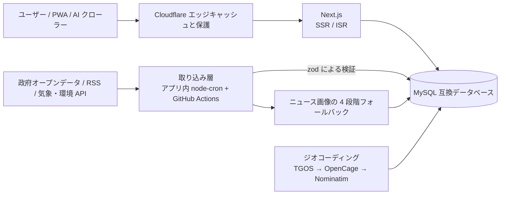

[繁體中文](README.md) | [English](README.en.md) | **日本語** | [한국어](README.ko.md)

# j172tw Healthz

**台湾の公衆衛生ニュース、暮らしに役立つツール、リアルタイムの防災・環境データを、インストール不要の 1 つのサイトに。**

[**今すぐ試す：health.j172.tw »**](https://health.j172.tw)

> 日本語版は機械翻訳です。母語話者によるレビューを歓迎します。

<!-- 以下の数値は tests/readme-scale-numbers.test.mjs がコードと照合します。変更時は 4 つの README を同時に更新してください。 -->

  
  
  
  

  
  
  
  
  
  
  
  

  
  
  
  

  
  
  

---

## これは何か

j172tw Healthz は、各官公庁やメディアに散らばっている**公衆衛生ニュース**、**暮らしに役立つツール**、**リアルタイムの防災・環境データ**を 1 つのサイトにまとめたものです。登録もインストールも不要で、広告もありません。現在、<!--scale:tools-->86<!--/scale--> 種類のインタラクティブなツールを提供し、<!--scale:news-sources-->103<!--/scale--> 件のニュースソースを集約し、<!--scale:cron-->45<!--/scale--> 件のアプリ内定期ジョブでデータを更新し続けています。

このプロジェクトは**ポートフォリオ**でもあります。データ収集、データベース、フロントエンド、地図、多言語対応、運用の自動化までを、リソースの限られた共有ホスティング上で長期運用できる公共情報サービスとして動かしています。

## 主な特長

### ニュース：公的機関と民間メディアを分けて扱い、画像切れを出さない
- 官公庁、メディア、非営利団体、ファクトチェック機関の健康・生活ニュースを集約します（RSS と、特定サイト向けの取得処理）。鮮度の基準と、ソースごとの障害の切り離しを備えています。
- 公的機関のニュースはサイト内で全文を表示します。民間メディアはタイトル・要約・サムネイルだけを保存し、クリックすると元のサイトへ移動します。
- **4 段階の画像フォールバック**：記事本来の画像、ストックフォト API（Pixabay、Pexels、Unsplash。レート制限のクールダウンを保存）、収集済み画像の再利用、ベクターカバー（`ThematicCover`）の順です。公的機関の発表には、あえてストックフォトを使わずベクターカバーを使い、信頼性のある印象を保ちます。
- ファクトチェック機関の記事カードには、「当サイトの判定ではなく、チェック機関によるもの」と明示します。

### 暮らしのツール：<!--scale:tools-->86<!--/scale--> 種類、7 カテゴリ
健康セルフチェック（BMI、カロリー、血圧、睡眠など）、受診と薬（診療所、薬局、医薬品許可証、救急外来の混雑状況）、介護と社会福祉、家族と子ども、防災・警報、環境と食の安全、交通・生活・文化。カテゴリ、ナビゲーション、フッター、`/tools` の一覧は、すべて 1 つのファイル [`catalog.ts`](lib/server/tools/catalog.ts) から生成されるため、互いにずれません。さらに、[`/guides`](https://health.j172.tw/guides) のシーン別ガイドと、[`/nearby`](https://health.j172.tw/nearby)（現在地を 1 回取得するだけで、AED、診療所、薬局、避難所などの最寄りの地点をまとめて検索）があります。

### リアルタイムの防災・環境データ
- 中央気象署の気象警報、台風バナー、大気質と紫外線指数、ダムの貯水状況、浸水センサー、断水のお知らせ、発電構成。
- 世界の主な地震を、USGS、EMSC、香港天文台、中央気象署の 4 つのソースから統合し、重複を除いて表示します。
- MapLibre による 3D 地球儀「Global Watch」で、大気質、災害、地震、感染症、台風を表示します。

### 施設マップ：数十万件の施設データ
診療所、薬局、AED、公衆トイレ、介護・保育施設などのデータは、住所の正規化と多段階のジオコーディング（TGOS、OpenCage、Nominatim の順。1 日の上限、ローテーション用カーソル、県市境界のチェック付き）を経て、Leaflet 地図に表示され、Google マップへの経路リンクも付きます。方針は、「データはまずデータベースに取り込み、フロントエンドはデータベースだけを読み、すべてのツールに予備データを用意して、空のページを見せない」ことです。

### 多言語とアクセシビリティ
- 繁体字中国語が既定で、English、日本語、한국어を `/en/`、`/ja/`、`/ko/` のパスで提供しています。日本語・韓国語は現時点では画面と名称を翻訳し、本文は中国語のままです。一覧は台湾の画数順で並べます。
- [アクセシビリティ宣言](https://health.j172.tw/accessibility)があります。台湾のアクセシビリティ指針 2.1 と WCAG 2.1 AA を設計目標とし、キーボードのアクセスキーを備えています。記事は音声読み上げや没入型リーダーで読め、ダークモードと PWA にも対応しています。
- AI 向け：`llms.txt`、`llms-full.txt`、JSON-LD の構造化データを提供しています。

## 規模

| 項目 | 数 | 数え方（単一の情報源） |
|---|---|---|
| インタラクティブなツール | <!--scale:tools-->86<!--/scale--> | [`lib/server/tools/catalog.ts`](lib/server/tools/catalog.ts) の `TOOL_CATALOG` |
| アプリ内定期ジョブ | <!--scale:cron-->45<!--/scale--> | [`lib/server/cron/registerJobs.ts`](lib/server/cron/registerJobs.ts) の `cron.schedule(` の呼び出し（GitHub Actions のスケジュールは含みません） |
| ニュースソース | <!--scale:news-sources-->103<!--/scale--> | [`lib/server/news/sourceCategories.ts`](lib/server/news/sourceCategories.ts)：官公庁 26、メディア 49、非営利団体 26、ファクトチェック 2（取得を終了したが過去記事を残しているソースを含む） |

これらの数値は手書きのため、[`tests/readme-scale-numbers.test.mjs`](tests/readme-scale-numbers.test.mjs) が `npm test` のたびにコードと照合します。4 つの README のどれかが古くなると、テストが失敗します。

## 技術スタック

  
   
  
  

- **フロントエンド**：Next.js（App Router）、React、TypeScript、Tailwind CSS、`next-themes`。施設マップは Leaflet、3D 地球儀は MapLibre GL。
- **バックエンド**：Next.js のサーバーサイドレンダリングと ISR、`mysql2` の接続プール、`zod` による検証、取得データの解析に `cheerio` と `fast-xml-parser`。
- **スケジュール**：アプリ内の `node-cron`。クリーンな送信元 IP が必要な処理や長時間のバッチには GitHub Actions を併用。
- **エッジとデプロイ**：前段の Cloudflare でキャッシュと保護。GitHub Actions がビルドし、ビルド済みの成果物を FTPS で配置、PM2 で常駐。

## アーキテクチャ

システムは、リソースの限られた共有ホスティング向けに意図して設計されています。サーバー側ではグローバルな `fetch()` を使わず（自作の `node:https` クライアントを使用）、リクエスト時の WASM 処理や画像変換を行わず、スキーマは起動時に `ensureSchema()` が冪等に補完します。詳細とトレードオフは[アーキテクチャ概要](docs/architecture.md)を参照してください。

## ドキュメント

開発、運用、インシデントの記録、機能ごとの意思決定は `docs/` にあります（繁体字中国語で記述）。この README では詳しくは扱いません。

- 総目次：[docs/README.md](docs/README.md)　アーキテクチャ：[docs/architecture.md](docs/architecture.md)
- ニュース：[01 ソース](docs/domains/01-news-sources.md)、[02 画像](docs/domains/02-news-images.md)、[03 地名・ランドマーク](docs/domains/03-news-geo-landmark.md)
- ツール：[04 情報設計](docs/domains/04-ia-navigation-civic.md)、[05 医療・食品医薬](docs/domains/05-tools-medical-food.md)、[06 福祉・家族](docs/domains/06-tools-welfare-family-culture.md)、[07 防災・環境・エネルギー](docs/domains/07-tools-disaster-environment-energy.md)
- データ：[08 施設と地図](docs/domains/08-facilities-geocode-maps.md)、[09 データベースとデータの正確性](docs/domains/09-database-data-integrity.md)
- 運用：[10 スケジュールと CI/CD](docs/domains/10-scheduling-sync-ci.md)、[11 ホスティングと運用](docs/domains/11-hosting-ops-incidents.md)
- フロントエンドと品質：[12 フロントエンドの安定性](docs/domains/12-frontend-stability.md)、[13 SEO・性能・多言語・AI](docs/domains/13-seo-performance-i18n-ai.md)

## ライセンスとデータの権利表示

本プロジェクトは、ソフトウェアのソースコードと構造化オープンデータを区別する複合的なデュアルライセンス（SPDX 識別子：`MIT AND CC0-1.0`）を採用しています。全文は [LICENSE](LICENSE) を参照してください。

| 範囲 | ライセンス | 内容 |
|---|---|---|
| ソフトウェアのソースコード | MIT License | Next.js アプリ、React コンポーネント、Tailwind CSS、ベクター SVG カバー、バックエンドのパイプライン、ネイティブ HTTP クライアント。自由に改変・配布・商用利用できます |
| 派生した構造化データとメタデータ | CC0-1.0 Universal | データベーススキーマと正規化辞書、AI によるニュースの構造化要約（`geo_summary`）、座標補完と試算モデルのアルゴリズム。著作権を放棄し、AI エージェントにも無条件で開放します |

* **ソースコード**：[MIT License](LICENSE)。
  * Copyright (c) 2023 Next.js Templates
  * Copyright (c) 2026 j172tw (https://health.j172.tw)
* **派生した構造化データとメタデータ**：[CC0-1.0 Universal パブリックドメイン提供宣言](https://spdx.org/licenses/CC0-1.0)のもとで公開し、世界中のオープンソースコミュニティと AI エージェントが自由に利用できます。
* **台湾政府オープンデータに関する表示**：本サイトが集約する上流の公衆衛生、気象、交通、環境観測データの権利は、中華民国（台湾）の衛生福利部、中央気象署、環境部、経済部、交通部、および各地方政府に帰属し、元データは[政府資料開放授權條款 第 1 版](https://data.gov.tw/license)（OGDL-Taiwan-1.0）に基づいて利用しています。

データの出典には、衛生福利部（中央健康保険署、国民健康署、疾病管制署、食品薬物管理署を含む）、中央気象署、環境部、水利署、交通部（TDX）、農業部、文化部、教育部、客家委員会、内政部、台湾電力公司などが公開しているデータが含まれます。本サイトの情報は参考用であり、医療上の助言ではありません。

## 作者について

[j172tw](https://github.com/j172) が開発・運用しています。不具合の報告やご提案は [Issues](https://github.com/j172/health/issues) へ。ぜひ[サイトも試してみてください](https://health.j172.tw)。
