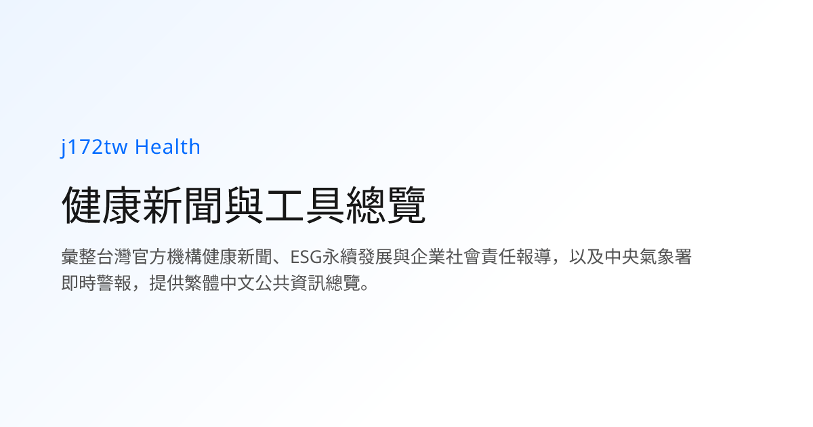
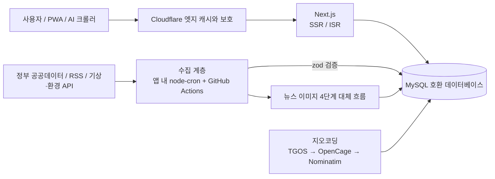

[繁體中文](README.md) | [English](README.en.md) | [日本語](README.ja.md) | **한국어**

# j172tw Healthz

**대만의 공중보건 뉴스, 생활 편의 도구, 실시간 재난·환경 데이터를 설치 없이 쓰는 하나의 웹사이트로 모았습니다.**

[**바로 체험하기: health.j172.tw »**](https://health.j172.tw)

> 한국어 버전은 기계 번역입니다. 원어민의 검토를 환영합니다.

<!-- 아래 숫자는 tests/readme-scale-numbers.test.mjs 가 코드와 대조해 검증합니다. 숫자를 바꿀 때는 README 네 개를 함께 수정하세요. -->

  
  
  
  

  
  
  
  
  
  
  
  

  
  
  
  

  
  
  

---

## 이 프로젝트는

j172tw Healthz는 여러 정부 기관과 언론사에 흩어져 있는 **공중보건 뉴스**, **생활 편의 도구**, **실시간 재난·환경 데이터**를 한곳에 모은 웹사이트입니다. 가입도 설치도 필요 없고 광고도 없습니다. 현재 <!--scale:tools-->86<!--/scale-->개의 대화형 도구를 제공하고, <!--scale:news-sources-->103<!--/scale-->곳의 뉴스 출처를 모으며, 앱 내 예약 작업 <!--scale:cron-->45<!--/scale-->개로 데이터를 계속 갱신합니다.

이 프로젝트는 **포트폴리오**이기도 합니다. 데이터 수집, 데이터베이스, 프런트엔드, 지도, 다국어 지원, 운영 자동화까지 자원이 제한된 공유 호스팅 위에서 장기간 운영 가능한 공공 정보 서비스로 돌아가고 있습니다.

## 주요 특징

### 뉴스: 공공기관과 민간 언론을 나눠 다루고, 깨진 이미지가 없습니다
- 정부 기관, 언론사, 비영리 단체, 팩트체크 기관의 건강·생활 뉴스를 모읍니다(RSS와 특정 사이트용 수집기). 신선도 기준과 출처별 장애 격리를 갖추고 있습니다.
- 공공기관 소식은 사이트 안에서 전문을 보여 줍니다. 민간 언론은 제목, 요약, 썸네일만 저장하고, 클릭하면 원문 사이트로 이동합니다.
- **4단계 이미지 대체 흐름**: 기사 본래의 이미지, 스톡 사진 API(Pixabay, Pexels, Unsplash, 요청 제한 쿨다운 저장), 이미 수집한 이미지 재사용, 벡터 커버(`ThematicCover`) 순입니다. 공공기관 발표에는 일부러 스톡 사진 대신 벡터 커버를 써서 진중한 인상을 유지합니다.
- 팩트체크 기관의 기사 카드에는 "이 사이트의 판정이 아니라 검증 기관의 판단"이라는 표시가 붙습니다.

### 생활 도구: <!--scale:tools-->86<!--/scale-->개, 7개 분류
건강 자가 평가(BMI, 칼로리, 혈압, 수면 등), 진료와 복약(의원, 약국, 의약품 허가증, 응급실 실시간 혼잡도), 장기요양과 사회복지, 가족과 아동, 재난 경보, 환경과 식품 안전, 교통·생활·문화. 분류, 내비게이션, 푸터, `/tools` 목록은 모두 하나의 파일 [`catalog.ts`](lib/server/tools/catalog.ts)에서 만들어지므로 서로 어긋나지 않습니다. 또한 [`/guides`](https://health.j172.tw/guides)의 상황별 가이드와 [`/nearby`](https://health.j172.tw/nearby)(위치를 한 번만 확인하면 AED, 의원, 약국, 대피소 등 가까운 긴급 지점을 한꺼번에 조회)가 있습니다.

### 실시간 재난·환경 데이터
- 중앙기상서의 기상 특보, 태풍 배너, 대기질과 자외선 지수, 저수지 수위, 침수 센서, 단수 안내, 발전 구성.
- 세계의 주요 지진을 USGS, EMSC, 홍콩천문대, 중앙기상서의 네 출처에서 통합하고 중복을 제거해 보여 줍니다.
- MapLibre로 만든 3D 지구본 "Global Watch"에서 대기질, 재난, 지진, 감염병, 태풍을 볼 수 있습니다.

### 시설 지도: 수십만 건의 시설 데이터
의원, 약국, AED, 공중화장실, 장기요양·보육 시설 등의 데이터는 주소 정규화와 다단계 지오코딩(TGOS, OpenCage, Nominatim 순. 일일 한도, 순환 커서, 시·현 경계 검증 포함)을 거쳐 Leaflet 지도에 표시되고, 구글 지도 길 안내 링크도 제공됩니다. 원칙은 "데이터는 먼저 데이터베이스에 넣고, 프런트엔드는 데이터베이스만 읽으며, 모든 도구에 대체 데이터를 두어 빈 화면을 보이지 않는다"입니다.

### 다국어와 접근성
- 기본 언어는 번체 중국어이며, English, 日本語, 한국어를 `/en/`, `/ja/`, `/ko/` 경로로 제공합니다. 일본어와 한국어는 현재 화면과 명칭을 번역하며, 본문은 중국어 그대로입니다. 목록은 대만식 획수 순으로 정렬합니다.
- [접근성 선언](https://health.j172.tw/accessibility)이 있습니다. 대만의 접근성 웹 개발 규범 2.1과 WCAG 2.1 AA를 설계 목표로 하며, 키보드 접근 키를 제공합니다. 기사는 음성으로 읽어 주거나 몰입형 리더로 볼 수 있고, 다크 모드와 PWA도 지원합니다.
- AI 친화: `llms.txt`, `llms-full.txt`, JSON-LD 구조화 데이터를 제공합니다.

## 규모

| 항목 | 수 | 계산 방식(단일 기준 출처) |
|---|---|---|
| 대화형 도구 | <!--scale:tools-->86<!--/scale--> | [`lib/server/tools/catalog.ts`](lib/server/tools/catalog.ts)의 `TOOL_CATALOG` |
| 앱 내 예약 작업 | <!--scale:cron-->45<!--/scale--> | [`lib/server/cron/registerJobs.ts`](lib/server/cron/registerJobs.ts)의 `cron.schedule(` 호출(GitHub Actions 일정은 제외) |
| 뉴스 출처 | <!--scale:news-sources-->103<!--/scale--> | [`lib/server/news/sourceCategories.ts`](lib/server/news/sourceCategories.ts): 정부 기관 26, 언론 49, 비영리 단체 26, 팩트체크 2(수집을 중단했지만 과거 기사를 보관하는 출처 포함) |

이 숫자들은 손으로 쓴 것이므로 [`tests/readme-scale-numbers.test.mjs`](tests/readme-scale-numbers.test.mjs)가 `npm test`를 실행할 때마다 코드와 대조합니다. README 네 개 중 하나라도 오래되면 테스트가 실패합니다.

## 기술 스택

  
   
  
  

- **프런트엔드**: Next.js(App Router), React, TypeScript, Tailwind CSS, `next-themes`. 시설 지도는 Leaflet, 3D 지구본은 MapLibre GL.
- **백엔드**: Next.js 서버 렌더링과 ISR, `mysql2` 연결 풀, `zod` 검증, 수집 데이터 파싱에 `cheerio`와 `fast-xml-parser`.
- **스케줄링**: 앱 안의 `node-cron`. 깨끗한 송신 IP가 필요하거나 오래 걸리는 배치 작업에는 GitHub Actions를 함께 사용.
- **엣지와 배포**: 앞단의 Cloudflare가 캐시와 보호를 담당하고, GitHub Actions가 빌드한 산출물을 FTPS로 배포하며, PM2가 프로세스를 상시 실행합니다.

## 아키텍처

이 시스템은 자원이 제한된 공유 호스팅을 염두에 두고 설계했습니다. 서버에서는 전역 `fetch()`를 쓰지 않고(자체 `node:https` 클라이언트 사용), 요청 시점에 WASM 처리나 이미지 변환을 하지 않으며, 스키마는 시작할 때 `ensureSchema()`가 멱등하게 보충합니다. 자세한 내용과 트레이드오프는 [아키텍처 개요](docs/architecture.md)를 참고하세요.

## 문서

개발, 운영, 장애 기록, 기능별 의사결정은 `docs/`에 있으며(번체 중국어로 작성) 이 README에서는 자세히 다루지 않습니다.

- 전체 목차: [docs/README.md](docs/README.md)　아키텍처: [docs/architecture.md](docs/architecture.md)
- 뉴스: [01 출처](docs/domains/01-news-sources.md), [02 이미지](docs/domains/02-news-images.md), [03 지명·랜드마크](docs/domains/03-news-geo-landmark.md)
- 도구: [04 정보 구조](docs/domains/04-ia-navigation-civic.md), [05 의료·식품의약](docs/domains/05-tools-medical-food.md), [06 복지·가족](docs/domains/06-tools-welfare-family-culture.md), [07 재난·환경·에너지](docs/domains/07-tools-disaster-environment-energy.md)
- 데이터: [08 시설과 지도](docs/domains/08-facilities-geocode-maps.md), [09 데이터베이스와 데이터 정확성](docs/domains/09-database-data-integrity.md)
- 운영: [10 스케줄링과 CI/CD](docs/domains/10-scheduling-sync-ci.md), [11 호스팅과 운영](docs/domains/11-hosting-ops-incidents.md)
- 프런트엔드와 품질: [12 프런트엔드 안정성](docs/domains/12-frontend-stability.md), [13 SEO·성능·다국어·AI](docs/domains/13-seo-performance-i18n-ai.md)

## 라이선스와 데이터 권리 고지

이 프로젝트는 소프트웨어 소스 코드와 구조화된 공개 데이터를 구분하는 복합 이중 라이선스(SPDX 식별자: `MIT AND CC0-1.0`)를 채택합니다. 전문은 [LICENSE](LICENSE)를 참고하세요.

| 범위 | 라이선스 | 내용 |
|---|---|---|
| 소프트웨어 소스 코드 | MIT License | Next.js 앱, React 컴포넌트, Tailwind CSS, 벡터 SVG 커버, 백엔드 파이프라인, 네이티브 HTTP 클라이언트. 자유롭게 수정·배포·상업적으로 이용할 수 있습니다 |
| 파생된 구조화 데이터와 메타데이터 | CC0-1.0 Universal | 데이터베이스 스키마와 정규화 사전, AI 뉴스 구조화 요약(`geo_summary`), 좌표 보완과 계산 모델 알고리즘. 모든 저작권을 포기하며 AI 에이전트에도 조건 없이 공개합니다 |

* **소스 코드**: [MIT License](LICENSE).
  * Copyright (c) 2023 Next.js Templates
  * Copyright (c) 2026 j172tw (https://health.j172.tw)
* **파생된 구조화 데이터와 메타데이터**: [CC0-1.0 Universal 퍼블릭 도메인 헌정](https://spdx.org/licenses/CC0-1.0)으로 공개하며, 전 세계 오픈소스 커뮤니티와 AI 에이전트가 자유롭게 사용할 수 있습니다.
* **대만 정부 공공데이터 고지**: 이 사이트가 모은 상위 공중보건, 기상, 교통, 환경 관측 데이터의 권리는 중화민국(대만)의 위생복리부, 중앙기상서, 환경부, 경제부, 교통부 및 각 지방정부에 있으며, 원본 데이터는 [정부 자료 개방 이용 허락 조건 제1판](https://data.gov.tw/license)(OGDL-Taiwan-1.0)에 따라 이용합니다.

데이터 출처에는 위생복리부(중앙건강보험서, 국민건강서, 질병관리서, 식품약물관리서 포함), 중앙기상서, 환경부, 수리서, 교통부(TDX), 농업부, 문화부, 교육부, 객가위원회, 내정부, 대만전력공사 등이 공개한 데이터가 포함됩니다. 이 사이트의 정보는 참고용이며 의료 조언이 아닙니다.

## 만든 사람

[j172tw](https://github.com/j172)가 개발하고 운영합니다. 문제 제보와 제안은 [Issues](https://github.com/j172/health/issues)로 보내 주세요. [사이트도 한번 써 보세요](https://health.j172.tw).
