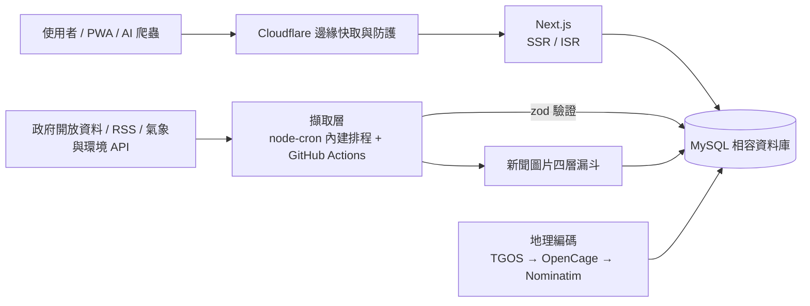

**繁體中文** | [English](README.en.md)

# j172tw Healthz

**臺灣公衛醫療新聞、生活便民工具與即時災害環境資料，整合在一個免安裝的網站。**

[**線上體驗 health.j172.tw »**](https://health.j172.tw)

<!-- 以下數字由 tests/readme-scale-numbers.test.mjs 對照程式碼驗證；改數字時四份 README 要一起改。 -->

  
  
  
  

  
  
  
  
  
  
  
  

  
  
  
  

  
  
  

---

## 這是什麼

j172tw Healthz 把分散在各機關與媒體的**公衛醫療新聞**、**生活便民工具**與**即時災害環境觀測資料**整理到同一個網站：打開就能用，不用註冊、不用安裝，也沒有廣告。目前收錄 <!--scale:tools-->86<!--/scale--> 款互動工具、<!--scale:news-sources-->103<!--/scale--> 個新聞來源，並以 <!--scale:cron-->47<!--/scale--> 項內建排程持續更新資料。

這個專案同時也是一份**作品集**：從資料擷取、資料庫、前端、地圖、多語系到維運自動化，在資源受限的共享主機上跑成可長期營運的公共資訊服務。

## 功能亮點

### 新聞：官方與媒體分流，圖片不破圖
- 彙整官方機構、媒體、公益團體與事實查核單位的健康與生活新聞（RSS 加上針對特定網站的擷取器），有新鮮度閘門與來源失敗隔離。
- 官方來源在站內呈現全文；商業媒體只保存標題、摘要與縮圖，點擊後回到原站，尊重著作權。
- **四層新聞圖片漏斗**：原文真圖 → 圖庫備援（Pixabay → Pexels → Unsplash，含限流冷卻）→ 重用已收錄的歷史圖庫 → 向量封面（`ThematicCover`）。官方公報刻意不配圖庫照片，改用向量封面，維持嚴肅性。
- 事實查核單位的卡片會明確標示「查核機構，非本站判定」。

### 生活便民工具：<!--scale:tools-->86<!--/scale--> 款，分成 7 大類
健康自我評估（BMI、熱量、血壓、睡眠…）、就醫與用藥（診所、藥局、藥品許可證、急診即時壅塞…）、長照與社會福利、婦幼與家庭、防災與示警、環境與食品安全、交通生活與文化。所有工具的分類、導覽、頁尾與 `/tools` 索引都由同一份 [`catalog.ts`](lib/server/tools/catalog.ts) 產生，不會彼此脫節。另有 [`/guides`](https://health.j172.tw/guides) 情境指南與 [`/nearby`](https://health.j172.tw/nearby)：定位一次，同時查 AED、診所、藥局、避難所等急用點位。

### 防災與環境即時資料
- 中央氣象署天氣示警、颱風橫幅、空氣品質與紫外線、水庫水情、淹水感測、停水通報、電力結構。
- 全球顯著地震整合 USGS、EMSC、香港天文臺與中央氣象署四個來源並去重。
- 「全球動態地球」以 MapLibre 3D 地球呈現空氣品質、災害、地震、疫情與颱風。

### 設施地圖：數十萬筆機構資料
診所、藥局、AED、公廁、長照、托育等設施資料，經過地址正規化與多層地理編碼（TGOS → OpenCage → Nominatim，含每日額度、輪替游標與縣市邊界防護），在 Leaflet 地圖上顯示並附 Google 地圖導航連結。原則是「資料先入庫、前台只讀資料庫、每個工具都有備援資料」，不讓使用者看到空白頁。

### 多語與無障礙
- 繁體中文為預設，另有 English、日本語、한국어（以 `/en/`、`/ja/`、`/ko/` 路徑提供；日、韓文目前翻譯介面與名稱，內文維持中文）。清單以臺灣筆劃序排序。
- 設有[無障礙宣告](https://health.j172.tw/accessibility)，以數位發展部《無障礙網頁開發規範 2.1》與 WCAG 2.1 AA 為設計目標，提供快速鍵導引；新聞可語音朗讀、沉浸閱讀；支援深色模式與 PWA。
- AI 友善：提供 `llms.txt`、`llms-full.txt` 與 JSON-LD 結構化資料。

## 規模數字

| 項目 | 數量 | 計算方式（單一事實來源） |
|---|---|---|
| 互動工具 | <!--scale:tools-->86<!--/scale--> 款 | [`lib/server/tools/catalog.ts`](lib/server/tools/catalog.ts) 的 `TOOL_CATALOG` |
| 內建排程 | <!--scale:cron-->47<!--/scale--> 項 | [`lib/server/cron/registerJobs.ts`](lib/server/cron/registerJobs.ts) 的 `cron.schedule(` 呼叫（另有 GitHub Actions 排程，不計入） |
| 新聞來源 | <!--scale:news-sources-->103<!--/scale--> 個 | [`lib/server/news/sourceCategories.ts`](lib/server/news/sourceCategories.ts)：官方機構 26、媒體 49、公益團體 26、事實查核 2（含已停止擷取、但歷史文章仍保留的來源） |

這些數字是手寫的，由 [`tests/readme-scale-numbers.test.mjs`](tests/readme-scale-numbers.test.mjs) 在每次 `npm test` 對照程式碼，四份 README 任何一份過時都會讓測試失敗。

## 技術棧

  
   
  
  

- **前端**：Next.js（App Router）、React、TypeScript、Tailwind CSS、`next-themes`；地圖用 Leaflet（設施）與 MapLibre GL（3D 地球）。
- **後端**：Next.js 伺服器端渲染與 ISR、`mysql2` 連線池、`zod` 資料驗證、`cheerio` 與 `fast-xml-parser` 解析來源資料。
- **排程**：`node-cron` 在應用程式內排程，搭配 GitHub Actions 處理需要乾淨出口 IP 或長時間的批次工作。
- **邊緣與部署**：Cloudflare 在前端做快取與防護；GitHub Actions 建置並以 FTPS 部署預建置產物，PM2 常駐。

## 架構

整套系統刻意為資源受限的共享主機設計：伺服器端不使用全域 `fetch()`，改走自家的 `node:https` 用戶端；不在請求當下做 WASM 或圖片轉檔；資料庫結構以冪等的 `ensureSchema()` 啟動時補齊。細節與取捨見 [系統架構總覽](docs/architecture.md)。

## 文件導覽

開發、維運、事故紀錄與各功能的決策都放在 `docs/`（文件以繁體中文撰寫），README 不展開：

- 總索引：[docs/README.md](docs/README.md)　系統架構：[docs/architecture.md](docs/architecture.md)
- 新聞：[01 新聞來源](docs/domains/01-news-sources.md)・[02 新聞圖片](docs/domains/02-news-images.md)・[03 新聞地標](docs/domains/03-news-geo-landmark.md)
- 工具：[04 資訊架構與導覽](docs/domains/04-ia-navigation-civic.md)・[05 醫療與食藥](docs/domains/05-tools-medical-food.md)・[06 社福與兒少家庭](docs/domains/06-tools-welfare-family-culture.md)・[07 防災環境能源](docs/domains/07-tools-disaster-environment-energy.md)
- 資料：[08 設施與地圖](docs/domains/08-facilities-geocode-maps.md)・[09 資料庫與正確性](docs/domains/09-database-data-integrity.md)
- 營運：[10 排程與 CI/CD](docs/domains/10-scheduling-sync-ci.md)・[11 主機與維運](docs/domains/11-hosting-ops-incidents.md)
- 前端與品質：[12 前端穩定性](docs/domains/12-frontend-stability.md)・[13 SEO、效能、多語與 AI 友善](docs/domains/13-seo-performance-i18n-ai.md)

## 雙重授權條款與資料權益宣告

本專案採行複合式雙重授權機制（SPDX 識別碼：`MIT AND CC0-1.0`），明確劃分「軟體工程代碼」與「結構化開放資料」，完整條文見 [LICENSE](LICENSE)。

| 範圍 | 授權 | 內容 |
|---|---|---|
| 軟體原始碼 | MIT License | Next.js App、React 元件、Tailwind CSS、向量 SVG 封面、後端管線與 Native HTTP Client；自由修改、分發與商業應用 |
| 衍生結構化資料與中繼標籤 | CC0-1.0 Universal | 資料庫 Schema 與正規化字典、AI 新聞結構化摘要（`geo_summary`）、地理座標補全與試算評估模型演算法；放棄一切著作權，無條件開放 AI Agent |

* **原始程式碼 (Code)**：採用 [MIT License](LICENSE)。
  * Copyright (c) 2023 Next.js Templates
  * Copyright (c) 2026 j172tw (https://health.j172.tw)
* **衍生結構化資料與中繼標籤 (Data & Schemas)**：以 [CC0-1.0 Universal 公眾領域貢獻宣告](https://spdx.org/licenses/CC0-1.0) 釋出，鼓勵全世界開源社群與 AI Agent 自由提取。
* **臺灣政府開放資料權益聲明**：
  本平臺所彙整之上游原始公衛、氣象、交通與環境監測數據，版權分屬中華民國衛生福利部、中央氣象署、環境部、經濟部、交通部及各地方政府所有，原始資料依據《[政府資料開放授權條款-第1版](https://data.gov.tw/license)》（OGDL-Taiwan-1.0）進行利用。

資料來源包括衛生福利部（含中央健康保險署、國民健康署、疾病管制署、食品藥物管理署）、中央氣象署、環境部、經濟部水利署、交通部（TDX）、農業部、文化部、教育部、客家委員會、內政部，以及台灣電力公司等機關與機構公開的資料。本站資訊僅供參考，不構成醫療建議。

## 關於作者

由 [j172tw](https://github.com/j172) 開發與維運。歡迎透過 [Issues](https://github.com/j172/health/issues) 回報問題或提出建議，也歡迎直接[到網站使用看看](https://health.j172.tw)。
